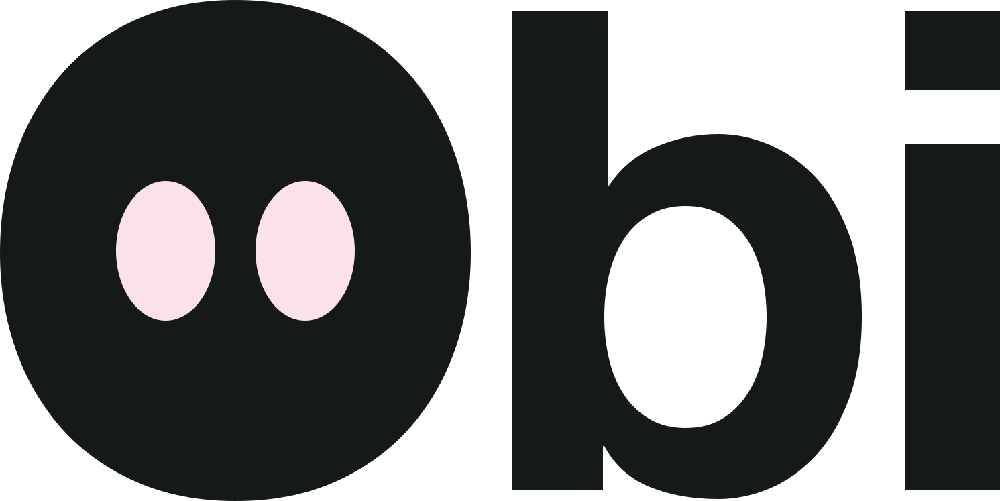

  <a href="https://hireobi.com">
    <picture>
      <source media="(prefers-color-scheme: dark)" srcset="https://raw.githubusercontent.com/Heysurface/.github/main/profile/obi-wordmark-night.svg">
      
    </picture>
  </a>

<h3 align="center">The Agent-Led Growth Platform</h3>

  Companies now grow through agents: AI assistants like ChatGPT and Claude, coding agents like Claude Code and Codex, personal agents like Muse and Dots. Heysurface, Inc. builds Obi to win that growth for founders and GTM teams.

  <a href="https://hireobi.com"><strong>hireobi.com</strong></a> ·
  <a href="https://github.com/Heysurface/cli">Install Obi</a> ·
  <a href="https://www.linkedin.com/company/surfacehq">LinkedIn</a>

## Obi, the AI Search Employee

**The AI Search Employee that drives revenue, right from Claude Code, Codex, Cursor or any terminal.**

It learns **your ICP**, finds **the missing pieces** that get AI to recommend you, and **does the work end to end**. Results in weeks, free to start.

- **ICP-Based AI Search.** Every strategy targets the buyers who sign.
- **Contextual Buyer Prompts.** It asks AI the questions your buyers ask, in their own words.
- **Missing-Piece Content.** It writes what AI can't find elsewhere, so it cites you fast.

Obi puts your buyers' questions to ChatGPT, Gemini and Google AI Overviews, and to Claude and Perplexity as add-ons.

> "We had never done SEO and never had an inbound lead. In six weeks, ChatGPT and Claude brought us 10 booked demos."
>
> Sage Kemer, CEO, Azops AI

## Obi, the Agent Search Employee

**Makes your site work for AI agents.**

- **Agent Readiness.** It checks what AI crawlers and agents can read on your site: robots rules, llms.txt, JavaScript rendering, indexability and structured data.
- **Agent Search.** It gets your product found when coding agents and personal agents choose what to use, from Claude Code and Codex to Muse and Dots.
- **Agentic commerce.** It prepares your product to be chosen and bought by agents acting for their users.

## Install

Obi runs as a CLI and a Skill inside the coding agent you already use. Install guide: [Heysurface/cli](https://github.com/Heysurface/cli).

---

Founded by [Nazim Zidi](https://github.com/Nazim23i). Obi is made by Heysurface, Inc.
